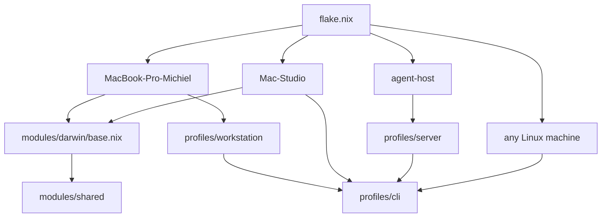

# nixos-config

A Nix flake managing **macOS** (nix-darwin) and **NixOS** system configuration for `michielbruins`. The Macs track `nixos-unstable`; the NixOS agent host tracks the stable `nixos-26.05` channel (see [Nixpkgs channels](#nixpkgs-channels)). The earlier, never-deployed NAS configuration was removed; the NAS runs TrueNAS SCALE.

| Host | Output | Platform | Status |
|---|---|---|---|
| MacBook Pro (M3 Max) | `darwinConfigurations.MacBook-Pro-Michiel` | aarch64-darwin | In use |
| Mac Studio (M1 Max, future inference) | `darwinConfigurations.Mac-Studio` | aarch64-darwin | Not yet deployed |
| Agent host (VM) | `nixosConfigurations.agent-host` | x86_64-linux | Not yet deployed; hardware and disk layout are placeholders |

## Features

- One command-line profile on every machine, on macOS and Linux
- [Home Manager](https://github.com/nix-community/home-manager) for user-level dotfiles (zsh, git, tmux, vim, etc.)
- [nix-darwin](https://github.com/LnL7/nix-darwin) for macOS system management
- [nix-homebrew](https://github.com/zhaofengli-wip/nix-homebrew) for declarative Homebrew cask management
- [nix-plist-manager](https://github.com/sushydev/nix-plist-manager) to capture and re-apply macOS settings on demand, outside `rig switch` (see [macOS settings](#macos-settings))

## Repository Structure

```
├── flake.nix               # Entry point; inputs and system outputs
├── .github/
│   └── workflows/          # CI: flake evaluation and per-host closure builds
├── hosts/
│   ├── darwin/
│   │   ├── MacBook-Pro-Michiel.nix  # MacBook entry point
│   │   ├── default.nix              # MacBook profile (GUI, dock, casks)
│   │   └── Mac-Studio.nix           # Mac Studio entry point
│   └── nixos/
│       ├── agent-host.nix           # NixOS agent-host VM entry point
│       └── agent-host/hardware.nix  # Placeholder VM hardware and disks
├── profiles/               # cli, workstation and server: what machines share
├── modules/
│   ├── shared/             # Cross-platform system features
│   └── darwin/             # macOS-only config (base, casks, dock)
├── overlays/               # Custom nixpkgs overlays (auto-loaded when present)
├── settings/               # Captured macOS settings, applied only by apply-settings
│   ├── <host>/system.nix   # System Settings per Mac, written by capture-settings
│   ├── shared.nix          # Optional, hand-written: settings both Macs share
│   ├── ignore.txt          # Option paths capture-settings leaves out
│   └── apps/               # manifest (domains and keys) and captured <domain>.plist
├── lib/                    # Helpers for the settings apps
└── apps/                   # Build/deploy shell scripts per architecture
    └── aarch64-darwin/
```

## Configuration Architecture

Hosts are explicit composition roots. What machines share lives in three profiles:

| Profile | Kind | Contents |
|---|---|---|
| `profiles/cli` | Home Manager | Shell, editor, command-line tools, direnv, and the seven-day cooldown for npm, Bun and uv. Every machine has it. |
| `profiles/workstation` | Home Manager | Adds runtimes, fonts, and SSH and Git configuration. MacBook only. |
| `profiles/server` | NixOS | Key-only SSH, Tailscale, one human account, and the CLI profile. |

Imports are explicit; there is no module registry or automatic import tree.



`modules/darwin/base.nix` holds the settings every Mac shares (Determinate-managed Nix, primary user, state
version, shared modules). Laptop and GUI settings stay in the MacBook profile. The Mac Studio leaves
out Homebrew, casks, Mac App Store apps, dock and input settings. It adds key-only Remote Login, Tailscale,
1Password and a loopback-only Ollama, and does not touch SIP, Gatekeeper, FileVault, Screen Sharing or power
settings. NixOS hosts do not import `modules/shared`.

### Flake outputs

| Output | Contents |
|---|---|
| `darwinConfigurations.MacBook-Pro-Michiel` | MacBook system (also exposed as the legacy alias `darwinConfigurations.aarch64-darwin`) |
| `darwinConfigurations.Mac-Studio` | Mac Studio system |
| `nixosConfigurations.agent-host` | Agent-host VM system |
| `checks.aarch64-darwin.{MacBook-Pro-Michiel,Mac-Studio}` | Darwin system closures |
| `checks.x86_64-linux.{agent-host,linux-cli}` | Agent-host system closure and the CLI profile on Linux |
| `homeConfigurations."michielbruins@{x86_64,aarch64}-linux"` | The CLI profile on a Linux machine this repository does not manage |
| `apps`, `devShells`, `formatter` | Imperative scripts (including the [settings apps](#macos-settings)), dev shell, `nixfmt` |

### Any other Linux machine

```bash
nix run github:nix-community/home-manager/release-26.05 -- switch --flake github:mrbruins/.nixos-config#michielbruins@x86_64-linux
```

### Nixpkgs channels

The Macs follow `nixpkgs` (`nixos-unstable`), as before, because nix-darwin `master` and Home Manager
track unstable. The agent host follows a separate `nixpkgs-stable` input (`nixos-26.05`). It is a
headless server that hosts other workloads, so it should get security backports without the churn of
unstable, and its updates can be reviewed apart from the Macs. Moving it to the next stable release
(`nixos-26.11`) is a deliberate input change; `system.stateVersion` stays `26.05`.

### Agent host placeholders

`hosts/nixos/agent-host/hardware.nix` assumes a UEFI (OVMF) VM with virtio devices, a root ext4 file system
labelled `nixos` and an EFI system partition labelled `boot`. Replace it with real values from
`nixos-generate-config` after the TrueNAS VM exists. Nested KVM needs the VM's CPU mode set to host
passthrough in TrueNAS. The user `michielbruins` logs in with SSH keys only and has no password, so set
one on the console before using `sudo`. Join the tailnet with `sudo tailscale up --qr`.

## Bootstrap — fresh Mac

Nothing here needs a secret, an SSH key or a checkout.

**Before wiping.** Finish and verify the backups, then unplug every external drive.

**Wipe and first login (by hand).**

1. System Settings → General → Transfer or Reset → Erase All Content and Settings.
2. In Setup Assistant, create the account `michielbruins` and turn on FileVault. Store the recovery key
   somewhere that works without this Mac.
3. In Terminal:

   ```bash
   curl -fsSLo /tmp/bootstrap https://raw.githubusercontent.com/mrbruins/.nixos-config/main/apps/aarch64-darwin/bootstrap
   bash /tmp/bootstrap Mac-Studio   # or MacBook-Pro-Michiel
   ```

   It installs the Command Line Tools and a pinned Determinate Nix, builds the host from GitHub, and asks
   before it activates anything.

**After the bootstrap (by hand).**

1. Open 1Password, choose the QR code sign-in, and scan the code with 1Password on your iPhone. If the app
   does not offer it, use the Secret Key or the setup code from 1Password.com.
2. In 1Password → Settings → Developer, turn on the SSH agent and the CLI integration.
3. MacBook: run `rig link` to clone and link the private dotfiles. It needs the SSH agent from step 2.
4. Join the tailnet. On the MacBook, sign in to the Tailscale app. On the Studio, run `sudo tailscale up --qr`
   and scan the code; the new node is called `mac-studio`, so remove the old one in the admin console.
5. Restore the captured macOS settings with `nix run github:mrbruins/.nixos-config#apply-settings`, if this
   host has any, and work through the [manual checklist](#what-apply-settings-cannot-restore).
6. Studio only: from another Mac, check that `ssh michielbruins@<LAN address>` works with your key and that
   `ssh -o PubkeyAuthentication=no` is refused.
7. Studio only: restart without logging in, then run `ssh michielbruins@<LAN address>` from the LAN. macOS asks for the
   account password once, unlocks FileVault and disconnects; the next connection uses your key. Do this while
   you can still reach the keyboard.

On the Studio, Screen Sharing, sleep settings and login items are not managed, because going headless is
deferred. Ollama runs as a system service on `127.0.0.1:11434`, with no models.

## CI

`.github/workflows/nix-checks.yml` runs on pull requests (stacked ones too), pushes to `main` and manual dispatch,
with read-only `contents` permission. It never activates a machine.

1. **Evaluate** (`ubuntu-latest`): `nix flake check --all-systems --no-build`.
2. **Build** each host's `checks.<system>.<host>` closure on a matching runner: `macos-latest` (ARM64) for
   `MacBook-Pro-Michiel` and `Mac-Studio`, `ubuntu-latest` (x86_64) for `agent-host` and `linux-cli`.

3. **Required checks** passes when evaluation and all builds passed, except the MacBook's, which only informs.
   `main` accepts nothing without it.

### Updates

`.github/workflows/update-lock.yml` opens a pull request every Monday that moves each branch-tracking input to
the newest revision that has been public for seven days, and lets it merge once the required checks pass. Run
it by hand with `gh workflow run update-lock.yml`. Inputs pinned to a version stay put until a person moves
them: `determinate` (together with `apps/aarch64-darwin/bootstrap`), `homebrew-brew` and `disko`. To skip the
cooldown for an urgent fix, run `nix flake update <input>` on a branch.

Actions are pinned to full commit SHAs. This repository is public, so standard hosted runners (including
ARM macOS) are free. If it becomes private, runs consume the plan's included minutes, macOS at a 10x
multiplier.

## Prerequisites (day-to-day)

- [Determinate Nix](https://github.com/DeterminateSystems/nix-installer) with flakes enabled
- 1Password with its SSH agent on, to push to GitHub; building and activating need no secret

## Usage

### macOS

```bash
rig build                 # build this Mac from the checkout, change nothing
rig switch                # build and activate the checkout, whatever branch it is on
rig update                # pull main, switch, update Homebrew and exempt tools, show drift
rig drift                 # what is installed or running but not declared
rig link                  # link the private dotfiles, cloning them first
rig try ffmpeg            # a shell with a package, without installing it
rig rollback previous     # or a generation number; without one it lists them and asks
rig pin                   # keep the running system as known-good (GC root, last two)
rig settings diff         # macOS settings, see below
```

Before `rig` is installed, use `nix run .#rig -- switch`. Try a change with `rig switch` on a branch, then open
a PR; you do not have to wait for CI (ADR 0001).

**Break glass (no GitHub, no network):** `rig rollback previous` needs neither. If `rig` itself is broken, run
`~/.nixos-config/apps/aarch64-darwin/rollback previous`. Rolling back re-activates a retained
generation without building anything. Homebrew and macOS changes are not reverted.

### macOS settings

System Settings and selected app preferences are captured from a running Mac into `settings/` and applied
back with a separate command. Nothing here is a nix-darwin or Home Manager module: `rig switch` never
writes these settings, so changing one in System Settings is not undone by the next switch. The repo is
the record for bootstrapping a Mac, or for an app installed later.

```bash
# Record this Mac's settings into the checkout (refuses on main or with uncommitted settings/)
rig settings capture      # --ui: also read settings macOS doesn't store (opens System Settings)
                                      # --snapshots: also menu bar layout and wallpaper
git diff -- settings                  # review, then commit and open a PR

# What differs between this Mac and the checkout; writes nothing
rig settings diff

# Apply the committed settings: everything, one part of System Settings, or one app
rig settings apply --dry-run
rig settings apply
rig settings apply --only applications.systemSettings.trackpad
rig settings apply --only com.surteesstudios.Bartender

# Find the preference keys a setting writes (Ctrl-C to stop)
rig settings watch com.surteesstudios.Bartender
```

The commands pick the host from the Mac's `LocalHostName`; pass `--host <name>` to override it.

- **System Settings** go through [nix-plist-manager](https://github.com/sushydev/nix-plist-manager), a
  pinned flake input with typed options per System Settings pane. Capture leaves out settings at the macOS
  default and the paths in `settings/ignore.txt`. The Dock's apps are in that list, because
  `modules/darwin/dock` sets them on every switch. Apply writes only the captured settings, uses `sudo`
  for the system-wide ones (firewall, power, sharing), and restarts Dock, Finder and other processes as
  needed. Key repeat and trackpad gestures take effect after logging out.
- **Apps** are listed in `settings/apps/manifest` with the exact top-level keys to keep. Whole
  preference domains are never captured, since they hold licence keys, window positions and network
  names, and this repository is public. Apply skips apps that aren't installed, and quits and reopens a
  running app around the write.
- nix-plist-manager is verified on the macOS build its defaults were recorded on (26A428). After a major
  macOS upgrade, check `settings-diff` before applying, and update the input on its own
  (`nix flake update nix-plist-manager`).

#### What apply-settings cannot restore

macOS keeps these outside the preferences system, or behind privacy protection, so set them by hand on a
new Mac:

- Privacy & Security permissions (TCC): Accessibility, Full Disk Access, Screen Recording, Camera,
  Microphone and Automation, per app
- FileVault
- Apple Account and iCloud sign-in, and iCloud sync choices
- Screen Time
- Wallpaper, unless captured with `--snapshots`
- Preferences of sandboxed apps whose container the terminal can't read (DeskPad, for example), unless
  the terminal has Full Disk Access
- Raycast, whose settings live in its own encrypted database: use Raycast's *Export Settings & Data*

### Build or evaluate a host without activating

```bash
nix build .#checks.aarch64-darwin.Mac-Studio
nix eval --raw .#nixosConfigurations.agent-host.config.system.build.toplevel.drvPath
nix flake check --all-systems --no-build
```

Building `x86_64-linux` on a Mac needs a remote Linux builder.

### Dev shell

Provides `bash` and `git`:

```bash
nix develop
```

## Shell (ZSH)

ZSH is the default interactive shell. It is configured entirely through [Home Manager](https://github.com/nix-community/home-manager)'s `programs.zsh` option — no manual `.zshrc` required.

| Layer | File | Purpose |
|---|---|---|
| Core (shared) | `profiles/cli/programs.nix` | ZSH enable, aliases, init script, integrations |
| macOS additions | `modules/darwin/home-manager.nix` | Login shell, Docker/Lima aliases |
| Shared system | `modules/shared/shell.nix` | System-level `programs.zsh.enable` |

### Initialization

The `initContent` block (prepended to `.zshrc`) handles:

- **Nix daemon**: Sources `/nix/var/nix/profiles/default/etc/profile.d/nix-daemon.sh` when present (needed on non-NixOS machines)
- **PATH extensions**: `~/.pnpm-packages/bin`, `~/.npm-packages/bin`, `~/bin`, `~/.local/share/bin`, `~/.local/bin`
- **`HISTIGNORE`**: Filters `pwd`, `ls`, and `cd` from history
- **`shell()` function**: Shorthand for `nix-shell '<nixpkgs>' -A <package>`

### Aliases

| Alias | Expands to | Notes |
|---|---|---|
| `ls` | `eza -ha --icons --git …` | Hidden files, icons, git status |
| `lz` | `eza --icons --git …` | No hidden files |
| `l` | `eza -lbhF -a --icons …` | Long format |
| `ll` | `eza -lah --icons …` | Long, all files |
| `llm` | `eza -lah … --sort=modified` | Sorted by modification time |
| `la` | `eza -lbhHigUmuSa …` | Extended metadata |
| `lx` | `eza -lbhHigUmuSa@ …` | Extended metadata + xattrs |
| `tree` | `eza --tree` | Directory tree |
| `man` | `batman` | Man pages via bat |
| `search` | `rg -p --glob '!node_modules/*'` | Ripgrep, node_modules excluded |
| `..` … `......` | `z ..` … `z ../../../../..` | Zoxide-backed traversal |

### Integrations

- **[zoxide](https://github.com/ajeetdsouza/zoxide)** — smart `cd` replacement; enabled with `enableZshIntegration = true`, invoked with `z`
- **[bat](https://github.com/sharkdp/bat)** + bat-extras — replaces `man`; includes `batdiff`, `batman`, `batwatch`, `prettybat`, `batpipe`

### macOS-specific additions

Defined in `modules/darwin/home-manager.nix`:

- Shell is set to `pkgs.zsh` in `users.users.${user}`
- Extra aliases: `docker` and `nerdctl` → `lima nerdctl` (Lima container runtime)`

## Adding Packages

| What | Where |
|---|---|
| CLI tool for every machine | `profiles/cli/packages.nix` |
| Runtime or desktop tool for the MacBook | `profiles/workstation/packages.nix` |
| macOS GUI app (Homebrew cask) | `modules/darwin/casks.nix` |
| Custom derivation / fork | New file in `overlays/` |

## Dotfiles

| Kind | Where | Edited |
|---|---|---|
| Generated | this repository: shell, Git, SSH, tmux, vim, npm, Bun, uv | here, then `rig switch` |
| Linked | the private `dotfiles` repository: Claude, OpenCode, Kilo, work identity | in place, by you or the app |
| Own sync | VS Code Settings Sync, Raycast | in the app |

Histories, sessions, caches and tokens are never dotfiles.

## Secrets

Secrets live only in 1Password, never in this repository or in a Nix store path. Nothing declared here needs
one to build or activate.
