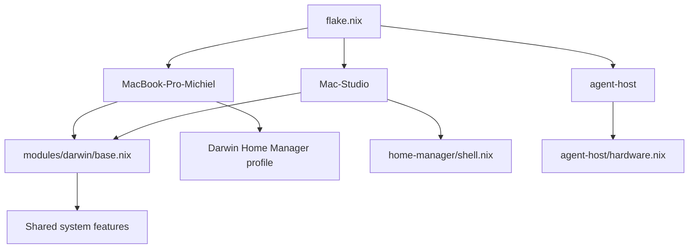

# nixos-config

A Nix flake managing **macOS** (nix-darwin) and **NixOS** system configuration for `michielbruins`. The Macs track `nixos-unstable`; the NixOS agent host tracks the stable `nixos-26.05` channel (see [Nixpkgs channels](#nixpkgs-channels)). The earlier, never-deployed NAS configuration was removed; the NAS runs TrueNAS SCALE.

| Host | Output | Platform | Status |
|---|---|---|---|
| MacBook Pro (M3 Max) | `darwinConfigurations.MacBook-Pro-Michiel` | aarch64-darwin | In use |
| Mac Studio (M1 Max, headless, future inference) | `darwinConfigurations.Mac-Studio` | aarch64-darwin | Not yet deployed; host name is a placeholder |
| Agent host (VM on TrueNAS SCALE) | `nixosConfigurations.agent-host` | x86_64-linux | Not yet deployed; hardware and disk layout are placeholders |

## Features

- Cross-platform config in `modules/shared/`, ready for NixOS hosts
- [Home Manager](https://github.com/nix-community/home-manager) for user-level dotfiles (zsh, git, tmux, vim, etc.)
- [nix-darwin](https://github.com/LnL7/nix-darwin) for macOS system management
- [nix-homebrew](https://github.com/zhaofengli-wip/nix-homebrew) for declarative Homebrew cask management
- [agenix](https://github.com/ryantm/agenix) for secrets management (age-encrypted, YubiKey-backed)

## Repository Structure

```
├── flake.nix               # Entry point; inputs and system outputs
├── .github/
│   ├── workflows/          # CI: flake evaluation and per-host closure builds
│   └── scripts/            # CI helper scripts
├── hosts/
│   ├── darwin/
│   │   ├── MacBook-Pro-Michiel.nix  # MacBook entry point
│   │   ├── default.nix              # MacBook profile (GUI, dock, casks, secrets)
│   │   └── Mac-Studio.nix           # Headless Mac Studio entry point
│   └── nixos/
│       ├── agent-host.nix           # NixOS agent-host VM entry point
│       └── agent-host/hardware.nix  # Placeholder VM hardware and disks
├── modules/
│   ├── shared/             # Cross-platform system features
│   ├── darwin/             # macOS-only config (base, casks, dock, secrets)
│   └── home-manager/       # Reusable user-level features
├── overlays/               # Custom nixpkgs overlays (auto-loaded when present)
└── apps/                   # Build/deploy shell scripts per architecture
    ├── aarch64-darwin/
    ├── aarch64-linux/
    └── x86_64-linux/
```

## Configuration Architecture

The flake uses a hybrid host-oriented and feature-oriented layout. Hosts remain
explicit composition roots, while reusable concerns are gradually extracted as
small modules. Imports are explicit; there is no module registry or automatic
import tree.



`modules/darwin/base.nix` holds the settings every Mac shares (Determinate-managed Nix, primary user, state
version, shared modules). Laptop, GUI and secrets settings stay in the MacBook profile. The Mac Studio leaves
out Homebrew, casks, Mac App Store apps, dock and input settings, and does not touch SIP, Gatekeeper,
FileVault, Remote Login or power settings; those belong to the reviewed phase 9 bootstrap. The agent host is
self-contained and does not import the shared modules, which carry workstation settings such as
`allowBroken`.

### Flake outputs

| Output | Contents |
|---|---|
| `darwinConfigurations.MacBook-Pro-Michiel` | MacBook system (also exposed as the legacy alias `darwinConfigurations.aarch64-darwin`) |
| `darwinConfigurations.Mac-Studio` | Mac Studio system |
| `nixosConfigurations.agent-host` | Agent-host VM system |
| `checks.aarch64-darwin.{MacBook-Pro-Michiel,Mac-Studio}` | Darwin system closures |
| `checks.x86_64-linux.agent-host` | Agent-host system closure |
| `apps`, `devShells`, `formatter` | Imperative scripts, dev shell, `nixfmt` |

### Nixpkgs channels

The Macs follow `nixpkgs` (`nixos-unstable`), as before, because nix-darwin `master` and Home Manager
track unstable. The agent host follows a separate `nixpkgs-stable` input (`nixos-26.05`). It is a
headless server that hosts other workloads, so it should get security backports without the churn of
unstable, and its updates can be reviewed apart from the Macs. Moving it to the next stable release
(`nixos-26.11`) is a deliberate input change; `system.stateVersion` stays `26.05`.

### Agent host placeholders

`hosts/nixos/agent-host/hardware.nix` assumes a UEFI (OVMF) VM with virtio devices, a root ext4 file system
labelled `nixos` and an EFI system partition labelled `boot`. Replace it with real values from
`nixos-generate-config` after the TrueNAS VM exists. Nested KVM needs the VM's CPU mode set to host
passthrough in TrueNAS. The user `michielbruins` logs in with SSH keys only and has no password, so set
one on the console before using `sudo`. Join the tailnet manually with `tailscale up` until auth keys are
handled as secrets.

## Bootstrap — fresh Mac

The `install` script handles everything end-to-end on a brand-new Mac — no manual prerequisites needed.

```bash
# 1. Clone the repo (git must already be available via Xcode CLT — the script installs it if not)
#    Or simply run the script directly if you already have curl and git:
bash <(curl -fsSL https://raw.githubusercontent.com/mrbruins/.nixos-config/main/apps/aarch64-darwin/install)
```

What the script does, step by step:

| Step | Action |
|---|---|
| 1 | Install **Xcode Command Line Tools** (`xcode-select --install`) if absent |
| 2 | Install **[Determinate Nix](https://github.com/DeterminateSystems/nix-installer)** if absent |
| 3 | **Clone** this repo (prompts for destination, default `~/Developer/nixos-config`) |
| 4 | Run **`apply`** — collects username, email, GitHub username & secrets repo name; performs token substitution across all config files |
| 5 | **SSH keys** — create new ed25519 keys or copy existing keys from a USB drive |
| 6 | Run **`build-switch`** — builds and activates the full nix-darwin configuration |

After the script finishes, open a new terminal to pick up all shell changes.

## CI

`.github/workflows/nix-checks.yml` runs on pull requests to `main`, pushes to `main` and manual dispatch,
with read-only `contents` permission. It never activates a machine.

1. **Evaluate** (`ubuntu-latest`): `nix flake check --all-systems --no-build`.
2. **Build** each host's `checks.<system>.<host>` closure on a matching runner: `macos-latest` (ARM64) for
   `MacBook-Pro-Michiel` and `Mac-Studio`, `ubuntu-latest` (x86_64) for `agent-host`.

Actions are pinned to full commit SHAs. This repository is public, so standard hosted runners (including
ARM macOS) are free. If it becomes private, runs consume the plan's included minutes, macOS at a 10x
multiplier (validation gate V09).

### Secrets in CI (1Password)

The `secrets` input is a private repository fetched over SSH. CI loads a read-only deploy key from
1Password with [`1password/load-secrets-action`](https://github.com/1Password/load-secrets-action),
authenticated by a service account that can read **only** the CI vault. The only GitHub-side secret is that
service account's token.

One-time setup (human):

1. In 1Password, create the vault `ci-nixos-config`. Keep nothing else in it.
2. In that vault, create an **SSH Key** item named `nix-secrets-deploy-key` (1Password generates an
   Ed25519 key). The workflow reads its `private key` field in OpenSSH format.
3. Add the item's public key to `mrbruins/nix-secrets` under *Settings → Deploy keys*, **without** write
   access.
4. Create a 1Password service account with **read-only** access to `ci-nixos-config` only, and store its
   token as the Actions secret `OP_SERVICE_ACCOUNT_TOKEN` in this repository.

Rotation: generate a new key in the item, replace the deploy key, done. No GitHub secret changes. Revoking the
service account cuts CI off from every 1Password secret at once.

Pull requests from forks and Dependabot do not receive Actions secrets, so their runs fail at the load step.

## Prerequisites (day-to-day)

- [Determinate Nix](https://github.com/DeterminateSystems/nix-installer) with flakes enabled
- SSH key at `~/.ssh/id_ed25519` (used as agenix identity for secrets)
- SSH agent running with access to the private `nix-secrets` repo

## Usage

### macOS

```bash
# Full bootstrap on a fresh Mac
nix run .#install

# First-time setup on a machine that already has Nix
nix run .#apply

# Build and activate (day-to-day usage)
nix run .#build-switch

# Build only, no activation
nix run .#build

# Roll back to a retained generation (lists them, asks which; or pass a number / "previous")
nix run .#rollback

# Pin the running system as known-good (kept as a GC root, last two)
nix run .#pin-known-good
```

**Break glass (no GitHub, no network):** run the scripts directly, because `nix run` evaluates the
flake: `~/.nixos-config/apps/aarch64-darwin/rollback previous`. Rolling back re-activates a retained
generation without building anything. Homebrew and macOS changes are not reverted.

### Build or evaluate a host without activating

```bash
nix build .#checks.aarch64-darwin.Mac-Studio
nix eval --raw .#nixosConfigurations.agent-host.config.system.build.toplevel.drvPath
nix flake check --all-systems --no-build
```

Building `x86_64-linux` on a Mac needs a remote Linux builder.

### Key management

```bash
nix run .#create-keys   # Generate a new age key
nix run .#copy-keys     # Copy keys from USB to ~/.ssh
nix run .#check-keys    # Verify key availability
```

### Dev shell

Provides `git`, `age`, and `age-plugin-yubikey`:

```bash
nix develop
```

## Shell (ZSH)

ZSH is the default interactive shell. It is configured entirely through [Home Manager](https://github.com/nix-community/home-manager)'s `programs.zsh` option — no manual `.zshrc` required.

| Layer | File | Purpose |
|---|---|---|
| Core (shared) | `modules/shared/home-manager.nix` | ZSH enable, aliases, init script, integrations |
| macOS additions | `modules/darwin/home-manager.nix` | Login shell, Docker/Lima aliases |
| Shared system | `modules/shared/shell.nix` | System-level `programs.zsh.enable` |

### Initialization

The `initContent` block (prepended to `.zshrc`) handles:

- **Nix daemon**: Sources `/nix/var/nix/profiles/default/etc/profile.d/nix-daemon.sh` when present (needed on non-NixOS machines)
- **PATH extensions**: `~/.pnpm-packages/bin`, `~/.npm-packages/bin`, `~/bin`, `~/.local/share/bin`, `~/.local/bin`
- **`HISTIGNORE`**: Filters `pwd`, `ls`, and `cd` from history
- **`shell()` function**: Shorthand for `nix-shell '<nixpkgs>' -A <package>`

### Aliases

| Alias | Expands to | Notes |
|---|---|---|
| `ls` | `eza -ha --icons --git …` | Hidden files, icons, git status |
| `lz` | `eza --icons --git …` | No hidden files |
| `l` | `eza -lbhF -a --icons …` | Long format |
| `ll` | `eza -lah --icons …` | Long, all files |
| `llm` | `eza -lah … --sort=modified` | Sorted by modification time |
| `la` | `eza -lbhHigUmuSa …` | Extended metadata |
| `lx` | `eza -lbhHigUmuSa@ …` | Extended metadata + xattrs |
| `tree` | `eza --tree` | Directory tree |
| `cat` | `bat` | Syntax-highlighted output |
| `man` | `batman` | Man pages via bat |
| `diff` | `batdiff` | Diff via bat |
| `search` | `rg -p --glob '!node_modules/*'` | Ripgrep, node_modules excluded |
| `..` … `......` | `z ..` … `z ../../../../..` | Zoxide-backed traversal |

### Integrations

- **[zoxide](https://github.com/ajeetdsouza/zoxide)** — smart `cd` replacement; enabled with `enableZshIntegration = true`, invoked with `z`
- **[bat](https://github.com/sharkdp/bat)** + bat-extras — replaces `cat`, `man`, `diff`; includes `batdiff`, `batman`, `batwatch`, `prettybat`, `batpipe`

### macOS-specific additions

Defined in `modules/darwin/home-manager.nix` via `lib.recursiveUpdate` on top of the shared config:

- Shell is set to `pkgs.zsh` in `users.users.${user}`
- Extra aliases: `docker` and `nerdctl` → `lima nerdctl` (Lima container runtime)`
- Session variable: `DOCKER_HOST=unix://$HOME/.lima/docker/sock/docker.sock`

## Adding Packages

| What | Where |
|---|---|
| Shared CLI tool | `modules/shared/packages.nix` |
| macOS-only CLI tool | `modules/darwin/packages.nix` |
| macOS GUI app (Homebrew cask) | `modules/darwin/casks.nix` |
| Custom derivation / fork | New file in `overlays/` |

## Secrets

Secrets are age-encrypted and stored in a private [`nix-secrets`](https://github.com/mrbruins/nix-secrets) repo. To reference a secret:

```nix
# modules/darwin/secrets.nix
age.secrets."my-secret" = {
  symlink = true;
  path = "/Users/${user}/.ssh/my-secret";
  file = "${secrets}/my-secret.age";
  mode = "600";
  owner = "${user}";
};
```
