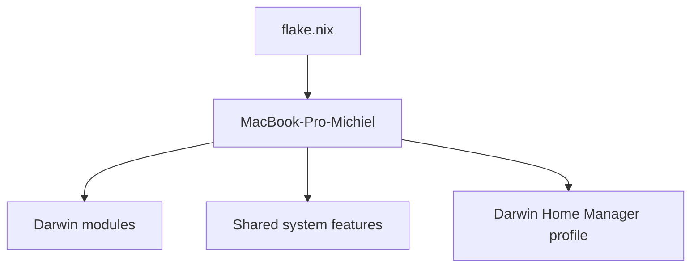

# nixos-config

A Nix flake managing **macOS** (nix-darwin) system configuration for `michielbruins`. Tracks `nixos-unstable`. NixOS hosts (the agent-host VM on the NAS, later a bare-metal NAS) will be added from scratch; the earlier, never-deployed NAS configuration was removed.

## Features

- Cross-platform config in `modules/shared/`, ready for NixOS hosts
- [Home Manager](https://github.com/nix-community/home-manager) for user-level dotfiles (zsh, git, tmux, vim, etc.)
- [nix-darwin](https://github.com/LnL7/nix-darwin) for macOS system management
- [nix-homebrew](https://github.com/zhaofengli-wip/nix-homebrew) for declarative Homebrew cask management
- [agenix](https://github.com/ryantm/agenix) for secrets management (age-encrypted, YubiKey-backed)

## Repository Structure

```
├── flake.nix               # Entry point; inputs and system outputs
├── hosts/
│   └── darwin/             # Explicit macOS host entry points
├── modules/
│   ├── shared/             # Cross-platform system features
│   ├── darwin/             # macOS-only config (casks, dock, secrets)
│   └── home-manager/       # Reusable user-level features
├── overlays/               # Custom nixpkgs overlays (auto-loaded when present)
└── apps/                   # Build/deploy shell scripts per architecture
    ├── aarch64-darwin/
    ├── aarch64-linux/
    └── x86_64-linux/
```

## Configuration Architecture

The flake uses a hybrid host-oriented and feature-oriented layout. Hosts remain
explicit composition roots, while reusable concerns are gradually extracted as
small modules. Imports are explicit; there is no module registry or automatic
import tree.



The named output is `darwinConfigurations.MacBook-Pro-Michiel`. The legacy `darwinConfigurations.aarch64-darwin`
alias remains available for compatibility.

## Bootstrap — fresh Mac

The `install` script handles everything end-to-end on a brand-new Mac — no manual prerequisites needed.

```bash
# 1. Clone the repo (git must already be available via Xcode CLT — the script installs it if not)
#    Or simply run the script directly if you already have curl and git:
bash <(curl -fsSL https://raw.githubusercontent.com/mrbruins/.nixos-config/main/apps/aarch64-darwin/install)
```

What the script does, step by step:

| Step | Action |
|---|---|
| 1 | Install **Xcode Command Line Tools** (`xcode-select --install`) if absent |
| 2 | Install **[Determinate Nix](https://github.com/DeterminateSystems/nix-installer)** if absent |
| 3 | **Clone** this repo (prompts for destination, default `~/Developer/nixos-config`) |
| 4 | Run **`apply`** — collects username, email, GitHub username & secrets repo name; performs token substitution across all config files |
| 5 | **SSH keys** — create new ed25519 keys or copy existing keys from a USB drive |
| 6 | Run **`build-switch`** — builds and activates the full nix-darwin configuration |

After the script finishes, open a new terminal to pick up all shell changes.

## Prerequisites (day-to-day)

- [Determinate Nix](https://github.com/DeterminateSystems/nix-installer) with flakes enabled
- SSH key at `~/.ssh/id_ed25519` (used as agenix identity for secrets)
- SSH agent running with access to the private `nix-secrets` repo

## Usage

### macOS

```bash
# Full bootstrap on a fresh Mac
nix run .#install

# First-time setup on a machine that already has Nix
nix run .#apply

# Build and activate (day-to-day usage)
nix run .#build-switch

# Build only, no activation
nix run .#build

# Roll back to previous generation
nix run .#rollback
```

### Key management

```bash
nix run .#create-keys   # Generate a new age key
nix run .#copy-keys     # Copy keys from USB to ~/.ssh
nix run .#check-keys    # Verify key availability
```

### Dev shell

Provides `git`, `age`, and `age-plugin-yubikey`:

```bash
nix develop
```

## Shell (ZSH)

ZSH is the default interactive shell. It is configured entirely through [Home Manager](https://github.com/nix-community/home-manager)'s `programs.zsh` option — no manual `.zshrc` required.

| Layer | File | Purpose |
|---|---|---|
| Core (shared) | `modules/shared/home-manager.nix` | ZSH enable, aliases, init script, integrations |
| macOS additions | `modules/darwin/home-manager.nix` | Login shell, Docker/Lima aliases |
| Shared system | `modules/shared/shell.nix` | System-level `programs.zsh.enable` |

### Initialization

The `initContent` block (prepended to `.zshrc`) handles:

- **Nix daemon**: Sources `/nix/var/nix/profiles/default/etc/profile.d/nix-daemon.sh` when present (needed on non-NixOS machines)
- **PATH extensions**: `~/.pnpm-packages/bin`, `~/.npm-packages/bin`, `~/bin`, `~/.local/share/bin`, `~/.local/bin`
- **`HISTIGNORE`**: Filters `pwd`, `ls`, and `cd` from history
- **`shell()` function**: Shorthand for `nix-shell '<nixpkgs>' -A <package>`

### Aliases

| Alias | Expands to | Notes |
|---|---|---|
| `ls` | `eza -ha --icons --git …` | Hidden files, icons, git status |
| `lz` | `eza --icons --git …` | No hidden files |
| `l` | `eza -lbhF -a --icons …` | Long format |
| `ll` | `eza -lah --icons …` | Long, all files |
| `llm` | `eza -lah … --sort=modified` | Sorted by modification time |
| `la` | `eza -lbhHigUmuSa …` | Extended metadata |
| `lx` | `eza -lbhHigUmuSa@ …` | Extended metadata + xattrs |
| `tree` | `eza --tree` | Directory tree |
| `cat` | `bat` | Syntax-highlighted output |
| `man` | `batman` | Man pages via bat |
| `diff` | `batdiff` | Diff via bat |
| `search` | `rg -p --glob '!node_modules/*'` | Ripgrep, node_modules excluded |
| `..` … `......` | `z ..` … `z ../../../../..` | Zoxide-backed traversal |

### Integrations

- **[zoxide](https://github.com/ajeetdsouza/zoxide)** — smart `cd` replacement; enabled with `enableZshIntegration = true`, invoked with `z`
- **[bat](https://github.com/sharkdp/bat)** + bat-extras — replaces `cat`, `man`, `diff`; includes `batdiff`, `batman`, `batwatch`, `prettybat`, `batpipe`

### macOS-specific additions

Defined in `modules/darwin/home-manager.nix` via `lib.recursiveUpdate` on top of the shared config:

- Shell is set to `pkgs.zsh` in `users.users.${user}`
- Extra aliases: `docker` and `nerdctl` → `lima nerdctl` (Lima container runtime)`
- Session variable: `DOCKER_HOST=unix://$HOME/.lima/docker/sock/docker.sock`

## Adding Packages

| What | Where |
|---|---|
| Shared CLI tool | `modules/shared/packages.nix` |
| macOS-only CLI tool | `modules/darwin/packages.nix` |
| macOS GUI app (Homebrew cask) | `modules/darwin/casks.nix` |
| Custom derivation / fork | New file in `overlays/` |

## Secrets

Secrets are age-encrypted and stored in a private [`nix-secrets`](https://github.com/mrbruins/nix-secrets) repo. To reference a secret:

```nix
# modules/darwin/secrets.nix
age.secrets."my-secret" = {
  symlink = true;
  path = "/Users/${user}/.ssh/my-secret";
  file = "${secrets}/my-secret.age";
  mode = "600";
  owner = "${user}";
};
```
